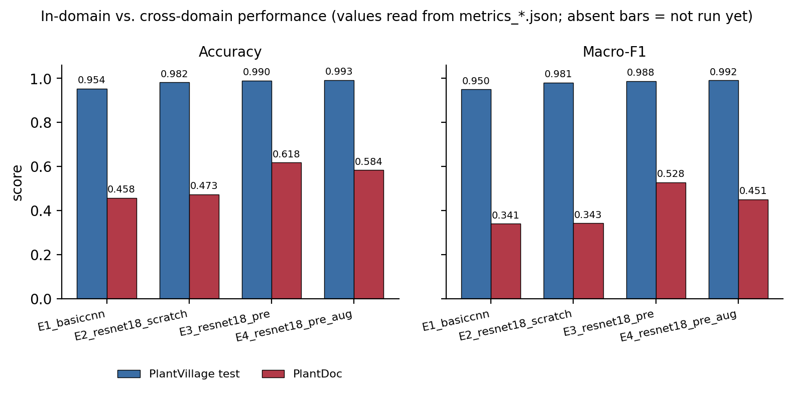
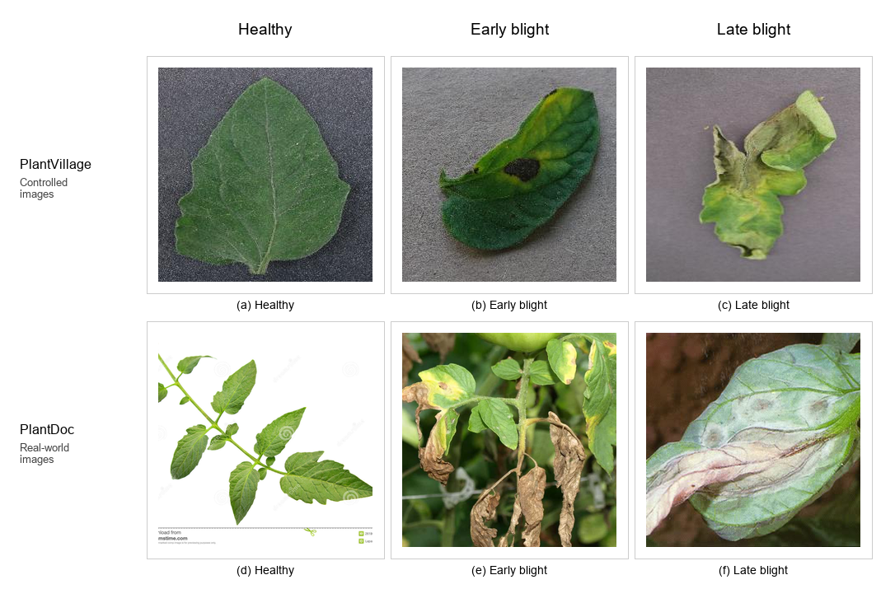

# Tomato Leaf Disease Classification: PlantVillage → PlantDoc

Course project for **AI3003 – Neural Networks and Deep Learning**.

How much accuracy does a tomato leaf disease classifier lose when it leaves the lab and meets
real field images — and how much of that loss can transfer learning or data augmentation recover?
This repository contains the code, the audited three-class subset, the trained-model logs and the
figures used in the project report.

---

## Results at a glance

All models are trained on the PlantVillage training split and evaluated twice: on the held-out
PlantVillage test split (in-domain, n = 675) and on PlantDoc (cross-domain, n = 262, never used for
training or model selection).

| ID | Model | Init. | Aug. | PlantVillage acc | PlantVillage macro-F1 | PlantDoc acc | PlantDoc macro-F1 |
|---|---|---|---|---|---|---|---|
| E1 | Basic CNN | random | no | 0.9541 | 0.9498 | 0.4580 | 0.3409 |
| E2 | ResNet18 | random | no | 0.9822 | 0.9805 | 0.4733 | 0.3429 |
| E3 | ResNet18 | ImageNet | no | 0.9896 | 0.9881 | **0.6183** | **0.5281** |
| E4 | ResNet18 | ImageNet | yes | **0.9926** | **0.9916** | 0.5840 | 0.4512 |
| E5 | = E4 checkpoint (no retraining) | ImageNet | yes | — | — | 0.5840 | 0.4512 |



**Three findings.**

1. The domain gap dominates everything else: accuracy drops by **37–51 points** when the same
   checkpoint is applied to field images.
2. **ImageNet initialisation is the only intervention with a clear effect** (+14.5 points
   cross-domain, non-overlapping 95 % confidence intervals). A deeper architecture alone
   (E1 → E2) changes nothing measurable.
3. **Augmentation does not help cross-domain** in this setting (58.4 % vs. 61.8 %, overlapping
   intervals), even though it is the best model in-domain. The failure is concentrated in the
   *healthy* class, whose recall collapses from 98.7 % to 1.6–12.7 %, which suggests the models
   rely on background and framing rather than on lesion appearance.

---

## Repository contents

| File | Purpose |
|---|---|
| `data_stats.py` | Scans both datasets, applies the label mapping, reports per-class counts (Table 1 of the report) |
| `make_fig1.py` | Builds the 2 × 3 sample comparison figure (PlantVillage vs. PlantDoc) |
| `make_figures.py` | Class-distribution chart and per-dataset sample grids |
| `train_baseline.py` | Trains BasicCNN / ResNet18, early stopping, in-domain and cross-domain evaluation |
| `plot_results.py` | Turns `runs/` into training curves, confusion matrices, comparison and error figures |
| `app.py` | Gradio demo: upload one leaf photo, get the three-class prediction |
| `examples/` | Four PlantDoc photos used as clickable samples in the demo |
| `runs/` | Per-epoch logs, metrics JSON, confusion matrices and per-image predictions for E1–E4 |
| `figures/` | Figures used in the report |
| `docs/dataset_sources.md` | Dataset sources, versions and what was excluded |
| `docs/results.md` | Full result tables, confidence intervals, training cost and reproduction commands |
| `RUNBOOK.md` | Step-by-step operating guide: environment, data, experiments, figures, demo |

---

## Quickstart

```bash
python -m venv .venv && .venv\Scripts\activate        # Windows
pip install -r requirements.txt --extra-index-url https://download.pytorch.org/whl/cpu
```

Data (not redistributed here — download from the original repositories):

```bash
git clone --depth 1 https://github.com/pratikkayal/PlantDoc-Dataset.git data/PlantDoc-Dataset
git clone --depth 1 --filter=blob:none --sparse https://github.com/spMohanty/PlantVillage-Dataset.git data/PlantVillage-Dataset
cd data/PlantVillage-Dataset
git sparse-checkout set raw/color/Tomato___healthy raw/color/Tomato___Early_blight raw/color/Tomato___Late_blight
```

Verify the subset, then reproduce an experiment:

```bash
python data_stats.py --root plantvillage=data/PlantVillage-Dataset/raw/color \
                     --root plantdoc=data/PlantDoc-Dataset --list-only

python train_baseline.py --data-root data/PlantVillage-Dataset/raw/color \
                         --model resnet18 --pretrained --epochs 20 --seed 42 \
                         --out-dir runs/E3_resnet18_pre

python plot_results.py --runs runs --out-dir figures
```

Cross-domain evaluation reuses a trained checkpoint and performs **no** training:

```bash
python train_baseline.py --model resnet18 --pretrained --eval-only \
                         --ckpt runs/E3_resnet18_pre/best.pt \
                         --plantdoc-root data/PlantDoc-Dataset \
                         --out-dir runs/E3_resnet18_pre
```

Model weights (`*.pt`) and the datasets are excluded by `.gitignore`; re-running the training
commands regenerates them.

### Demo

```bash
python app.py          # then open http://127.0.0.1:7860
```

`app.py` loads `runs/E3_resnet18_pre/best.pt`, applies the same preprocessing as the evaluation
script, and returns the three class probabilities. Train E3 first if the checkpoint is missing.


---

## Dataset

Only three tomato classes are used: **healthy**, **early blight**, **late blight**.

| Class | PlantVillage folder | n | PlantDoc folder | n |
|---|---|---|---|---|
| healthy | `Tomato___healthy` | 1,591 | `Tomato leaf` | 63 |
| early blight | `Tomato___Early_blight` | 1,000 | `Tomato Early blight leaf` | 88 |
| late blight | `Tomato___Late_blight` | 1,909 | `Tomato leaf late blight` | 111 |
| **total** | | **4,500** | | **262** |

PlantVillage is split once, stratified by class, into 70 % / 15 % / 15 % (`seed = 42`), giving
3,150 / 675 / 675 images. PlantDoc contributes no training or validation images; it is used only
for the final cross-domain evaluation. The remaining PlantDoc classes (six other tomato diseases
and 21 other crops) are excluded, and the mapping is applied by an explicit table rather than by
folder name. See `docs/dataset_sources.md` for versions and exclusions.



---

## Experimental protocol

- Input 224 × 224, ImageNet normalisation for every model (including the randomly initialised one).
- Adam, cosine annealing, batch size 32, cross-entropy; 1e-3 head / 1e-4 pretrained backbone.
- Up to 20 epochs with early stopping (patience 5 on validation macro-F1); the checkpoint with the
  best validation macro-F1 is the only one evaluated.
- Metrics: accuracy, macro-F1 (averaged over classes with non-zero support), per-class
  precision/recall/F1 with support, 3 × 3 confusion matrix, and 95 % Wilson confidence intervals.
- Hardware: NVIDIA GeForce RTX 3060 Laptop GPU (CUDA 12.1, PyTorch 2.5.1).

---

## Team and contributions

| Member | Contribution |
|---|---|
| Jing Haoyang | Literature review, related-work comparison, DOI verification, language revision |
| Liao Fandi | Training and evaluation code, experiments E1–E4, cross-domain evaluations |
| Luo Jiyan | Figures and tables, confidence intervals, per-class and error analysis |
| Luo Yitong | Project coordination, integration of drafts, packaging and submission |
| Sun Duoyang | Dataset acquisition and audit, label mapping, class statistics |

---

## References

1. S. P. Mohanty, D. P. Hughes, M. Salathé. Using deep learning for image-based plant disease detection. *Frontiers in Plant Science*, 7:1419, 2016.
2. D. Singh, N. Jain, P. Jain, P. Kayal, S. Kumawat, N. Batra. PlantDoc: A dataset for visual plant disease detection. *CoDS-COMAD*, 2020, pp. 249–253.
3. K. He, X. Zhang, S. Ren, J. Sun. Deep residual learning for image recognition. *CVPR*, 2016, pp. 770–778.
4. C. Shorten, T. M. Khoshgoftaar. A survey on image data augmentation for deep learning. *Journal of Big Data*, 6:60, 2019.
5. K. Xiang, D. Shi, X. Zhu. Quantifying the reliability gap in cross-domain plant disease classification. *Frontiers in Plant Science*, 17, 2026.

## Licence and data use

The code is released for course assessment only. The datasets are not redistributed: all images
belong to their original authors and are downloaded from the repositories cited above.
